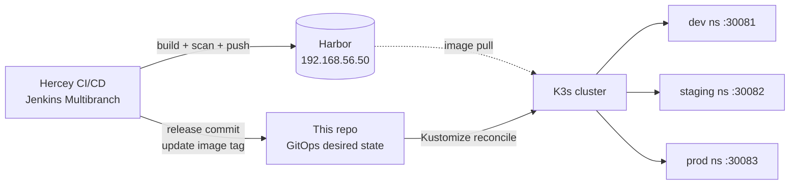
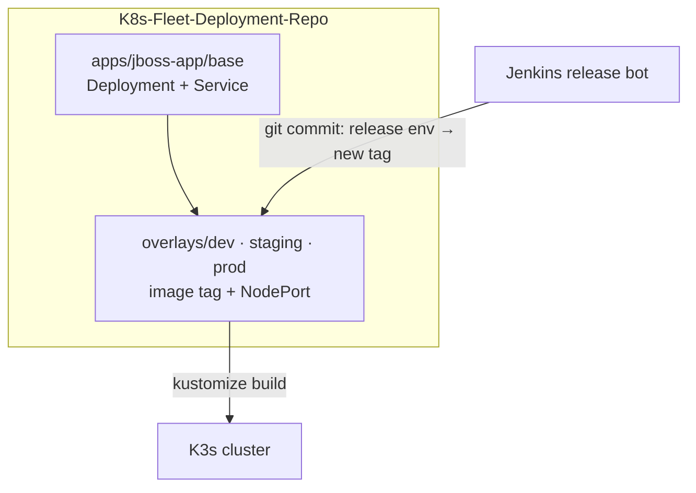

# K8s Fleet — GitOps Deployment Repo


> ### Ownership & scope
> Every manifest, the Kustomize layout and the release automation in this repository are
> **my work ([Kithupa G](https://github.com/KithupaG))**.
>
> The **`jboss-app` (Hercey) application** running here was built by
> **[Nimuthu](https://github.com/Nimuthu)**; its image is built, scanned and published by the
> separate **[Hercey CI/CD repository](https://github.com/KithupaG/Hercey-DevOps)**. This repo holds
> only the **Kubernetes desired state** — it never builds the application.

A **git-as-source-of-truth** deployment repository that describes the desired Kubernetes state of the
`jboss-app` across three environments — **`dev`**, **`staging`** and **`prod`** — using
**Kustomize**. Each environment gets its own namespace, image tag and `NodePort`, and the CI pipeline
**commits the new image tag back here** whenever an artifact is published to Harbor. Promoting a
release is therefore a Git commit, never a manual `kubectl` edit.

---

## Architecture





---

## Repository structure

```text
.
├── apps/
│   └── jboss-app/
│       ├── base/                     # Environment-agnostic Kustomize base
│       │   ├── deployment.yaml       #   jboss-app Deployment (probes, resources)
│       │   ├── service.yaml          #   ClusterIP Service (port 8080)
│       │   └── kustomization.yaml
│       ├── overlays/
│       │   ├── dev/kustomization.yaml      # image tag + NodePort 30081
│       │   ├── staging/kustomization.yaml  # image tag + NodePort 30082
│       │   └── prod/kustomization.yaml     # image tag + NodePort 30083
│       ├── dev.yaml                  # per-env bundle descriptor (namespace + overlay)
│       ├── staging.yaml              # per-env bundle descriptor
│       └── prod.yaml                 # per-env bundle descriptor
└── README.md
```

---

## Environments

| Environment | Namespace | Overlay | Harbor image | Current tag | NodePort |
|-------------|-----------|---------|--------------|-------------|:--------:|
| dev | `dev` | `overlays/dev` | `192.168.56.50/hercey-dev/hercey` | `dev-1.0.10` | 30081 |
| staging | `staging` | `overlays/staging` | `192.168.56.50/hercey-staging/hercey` | `staging-1.0.23` | 30082 |
| prod | `prod` | `overlays/prod` | `192.168.56.50/hercey/hercey` | `1.0.22` | 30083 |

Each overlay is a thin Kustomize layer on top of the shared base:

* **`images:` transformer** — rewrites the base image (`hercey/jboss-app`) to the environment's
  Harbor project and the exact release tag.
* **Service patch** — switches the `ClusterIP` Service to `NodePort` and pins the per-environment
  node port.

```yaml
# overlays/prod/kustomization.yaml (abridged)
resources:
  - ../../base
images:
  - name: 192.168.56.50/hercey/jboss-app
    newName: 192.168.56.50/hercey/hercey
    newTag: 1.0.22
patches:
  - target: { kind: Service, name: jboss-app-service }
    patch: |-
      - op: replace
        path: /spec/type
        value: NodePort
      - op: add
        path: /spec/ports/0/nodePort
        value: 30083
```

---

## GitOps release flow

Promotion is expressed entirely in Git. In this GitOps model, when the pipeline publishes an artifact
to Harbor the next hop is a commit here:

1. CI builds, scans and pushes the image to Harbor.
2. A **release bot** (`Jenkinsci@local`) commits the new tag to the matching overlay, e.g.
   `release(staging): update jboss-app image to 1.0.22-rc [skip ci]`.
3. The cluster reconciles the committed state — **the commit is the deployment**.

```
release(dev):     update jboss-app image to 1.0.10-SNAPSHOT
release(staging): update jboss-app image to 1.0.23-rc
release(prod):    update jboss-app image to 1.0.22
```

The `[skip ci]` suffix tells the pipeline not to re-trigger on its own release commits, preventing a
build loop.

---

## Deploy & rollback

There is nothing to "run" — the cluster converges on the committed state. To inspect or apply the
rendered manifests manually:

```bash
# Preview what an environment will deploy
kustomize build apps/jboss-app/overlays/prod

# Apply directly (if not using a GitOps controller)
kubectl apply -k apps/jboss-app/overlays/prod
```

**Rollback** is a `git revert` (or `git checkout <previous-commit> -- <overlay>`): the image tag
returns to its last good value and the cluster reconciles back.

---

## Platform history — how this evolved

This repo is a record of the GitOps approaches the platform moved through:

1. **Argo CD** — the first iteration shipped per-app Argo `Application` manifests (`argo-apps/`).
2. **Rancher Fleet** — replaced Argo CD with a `fleet.yaml` using label-based
   `targetCustomizations` (`staging-env: "true"`, `prod-env: "true"`) to select the overlay per
   cluster.
3. **Explicit per-environment bundles (current)** — `fleet.yaml`'s implicit label matching was
   replaced with explicit `dev.yaml` / `staging.yaml` / `prod.yaml` descriptors, and the missing
   `resources: ../../base` was added to `overlays/prod`.
4. **Per-environment NodePorts (current)** — each environment's Service was exposed on a dedicated
   node port (dev `30081`, staging `30082`, prod `30083`).

> This GitOps repo is the earlier deployment path. The current Hercey pipeline deploys the
> **Helm chart straight from Harbor OCI** (`helm upgrade --install`), removing the separate GitOps
> hop. This repository is kept as a working reference of the Kustomize/Fleet design.

---

## Related repositories

| Repository | Role |
|------------|------|
| [Hercey-DevOps](https://github.com/KithupaG/Hercey-DevOps) | Application + CI/CD pipeline (builds & publishes the image this repo deploys) |
| **K8S-Fleet-Deployment-Repo** | This repo — Kubernetes desired state (GitOps) |

---

## Credits

* **Application (Java/JBoss backend & web UI):** [Nimuthu](https://github.com/Nimuthu)
* **DevOps, GitOps layout & release automation:** [Kithupa G](https://github.com/KithupaG)

Repository: <https://github.com/KithupaG/K8S-Fleet-Deployment-Repo>
